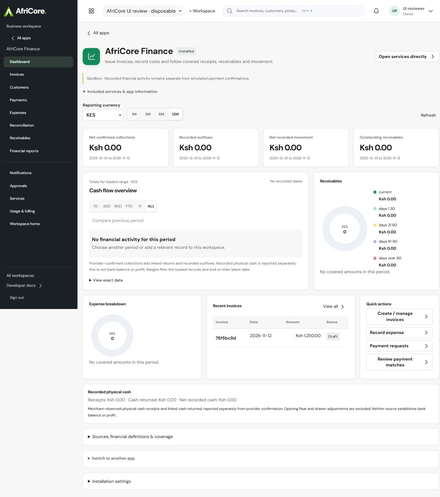
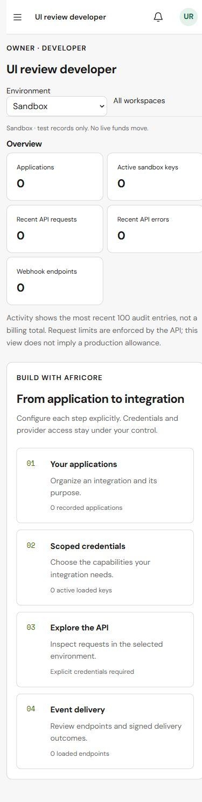

# Platform UI transformation — implementation checkpoint

12 November 2026 · AfriCore `Sevqo/afriscore` · baseline `84e4bd8` · branch `codex/platform-ui-transformation`.

## 1. Executive summary

The frontend now has an integrated app launcher, a searchable app directory, contextual section navigation, lazy-loaded workspaces, richer historical charts and targeted operational layouts. This is a substantial working checkpoint, **not full assignment completion**. All 14 existing apps have source changes or integrated shared layout changes and primary-screen review. All 92 registry navigation sections were opened and captured at desktop/mobile widths. Remaining individual visual acceptance, configured-state workflows, service/workspace coverage and release gates are explicit in the tracker.

The supplemental instruction governs scope: Website, Marketing, Support and Subscriptions were not built. No manufacturing, Studio, hosting migration, authentication rewrite or backend/schema change was introduced. Work was performed in a separate AfriCore checkout; LeadFlow source files were not edited.

## 2. Original UI problems

The app portfolio loaded eagerly. App metadata and related-app cards pushed working content down the page. Directory filtering was absent. Some app defaults disagreed with their first registry section. Quotation action forms expanded every row, People overview exposed unrelated setup forms, and checkbox alignment produced excessive space. The initial Finance screenshots taken during this work were already implementation iterations, not original-source baselines.

## 3. Design principles

Retain AfriCore's green/neutral identity, dark operational navigation, compact content hierarchy, explicit source/currency semantics and native controls. Give working records priority over explanatory metadata. Keep empty and setup states honest. Charts never generate random business metrics.

## 4. Attached Apple Design reference

Applied immediate press feedback, optical sizing, heading tracking, direct pointer tracking with grab offsets, clear drop targets, native keyboard alternatives, focus restoration and reduced-motion/transparency/contrast support. CRM drag handles track the pointer; stage changes retain the existing optimistic update/rollback and API contract. No decorative spring library, sound, haptics, blur treatment or blocking animation was added.

## 5. Design system

Shared controls now include keyboard-operable segmented periods, compact tabular-number tables, aligned checkboxes with usable label targets, bounded dialogs, skip links and conservative surface treatments. Existing semantic tokens and fonts remain canonical. New components are used by the actual application.

## 6. Global navigation

The launcher searches current authorized app metadata and opens installed apps or requirement screens. It uses the existing focus-managed Overlay and scope guards. The directory supports text and installed-only filtering. App metadata collapses; related apps sit below working content. Registry defaults now select the first app section. A duplicated Automations Approvals item was found during route QA and removed. Direct-service entry clears stale app context while retaining existing access checks.

## 7. Charts and analytics

InteractiveChart supports line/area variants, exact hover/touch readouts, native keyboard date exploration, legends, exact tables and preceding equal-length historical-window comparisons. Earlier loaded history is required; forecasts and all-history views do not imply a previous period. Sparse dates remain gaps and unknown comparison values remain unavailable. Four new tests cover sparse alignment, missing history, year boundaries and explicit as-of dates.

Analytics uses authorized creation aggregates for line charts and order-status counts for drillable bars. Automations visualizes loaded execution states. Finance and Personal use the area variant. Data scope, units, negative movement and financial assurance are preserved. Previous-period UI with a populated multi-period connected dataset still needs browser qualification; algorithm tests passed.

## 8. Wave 1 applications

Finance: period/currency controls, tighter metrics, chart-first layout, receivable/expense composition and recent-invoice inspection. CRM: pointer handles, visible stage targets, per-currency stage values, compact move disclosures and keyboard stage updates. Inventory: explicit loaded-record filters, stock facts inspector and movement navigation. Sales: quotation/customer/status filters and collapsed action/price-list controls. Analytics and Automations use the chart system above.

## 9. Wave 2 applications

Work has project directory cards and compact task controls. Documents has a labelled responsive register, visible private-upload target and compact filters. People overview focuses on profiles instead of exposing every setup form. Procurement uses an operational register instead of repeated record cards. Accounting setup uses a compact field grid and shared accessible controls. Business ID puts the existing Passport content ahead of a collapsed assurance guide. Existing privacy, posting, file and employment permissions remain authoritative.

## 10. Existing Wave 3 applications

Commerce has a first-store journey that opens the existing draft form. POS has a first-register journey and a sticky desktop basket. These remain sandbox/evaluation interfaces. Full storefront publication, cashier policy, shifts, sale/return and populated counter qualification remain outstanding.

## 11. Direct services

My Services/Explore Services support cards and a compact list, with an explicit matching count. Existing pricing, units, activation reviews and usage disclosures remain. A filtered Invoicing service was opened independently and reviewed. The catalog contains 35 services across workspace kinds. All 24 active Business service entry points were opened and captured at desktop/mobile widths without observed document overflow or visible alerts. Independent acceptance of every service workflow and other activation states is not complete.

## 12. Personal workspace

Refined metrics, area-chart support, responsive quick actions, skip navigation and shared forms. Desktop/mobile captures exist. Zero/empty records in the disposable workspace are genuine fixture state, not financial activity. Complete configured-service journeys remain pending.

## 13. Business workspace

The dark contextual shell, compact header, app switching and current scoped search were exercised using a synthetic local account. Organization/environment guards, request cancellation and backend membership enforcement were preserved.

## 14. Developer workspace

Added an integration journey linking application, credential, API Explorer and webhook screens, with recorded loaded counts and no exposed credentials. Desktop/mobile screenshots were reviewed. Configured API/key/webhook workflows remain unqualified in this new disposable workspace.

## 15. Shared settings, billing and profile

Shared forms, tables, checkboxes, focus and dialog improvements apply. Existing account security and collection-disabled billing behavior remain. Account settings now has sticky section navigation to profile, email, password, sessions and recovery; desktop/mobile rendering and the Sessions anchor were checked without changing credentials. Dedicated refinement and complete regression of the remaining shared pages remain outstanding.

## 16. Responsive implementation

Finance was measured at requested widths 320, 375, 390, 768, 1024, 1280, 1440 and 1920 without observed document overflow. Host rounding produced 769/1281 for two observations; actual values are saved. All 92 registry sections passed document-width/visible-alert checks at desktop 1440 and mobile 390 in their tested state. Inventory inspection was checked at 320. These checks do not establish absence of every local clipping defect or physical Safari compatibility.

## 17. Accessibility results

Retained semantic tables, named dialogs, native forms, visible focus and exact chart data alternatives. Added skip links, segmented-control keyboard behavior, usable checkbox labels and CRM keyboard stage choices. Mobile search found an authorized product; Escape closed the dialog and restored trigger focus. Comprehensive WCAG 2.2 AA, screen-reader and physical touch-device certification remain pending.

## 18. Performance results

Production builds emit separate app workspace chunks instead of eagerly loading the complete portfolio. A scoped error boundary keeps the shell available if an app chunk or render fails, with explicit reload recovery. No dependency was added. No before/after hosted latency, bundle-baseline or Core Web Vitals measurement is claimed. Existing scoped memory caching and backend authorization were not changed.

## 19. Visual evidence

Actual isolated-browser captures are in [evidence/ui-transformation](evidence/ui-transformation/). There are desktop/mobile primary captures for all 14 apps, 184 registry-section captures, Personal/Developer captures and representative dialog/workflow captures. [Registry observations](evidence/ui-transformation/registry-route-checks.json) distinguish render checks from business acceptance.

The previously approved Finance image and original before screenshots were not supplied or available in this checkout. No comparison image was fabricated. Some initial captures precede subsequent corrections; route captures represent the later reviewed implementation checkpoint. Critical ledger and Work corrections were recaptured during final acceptance.

## 20. Functional and regression results

- Frontend build, 67 public prerenders and **66 frontend tests passed**.
- SQLite: **435 discovered, 434 passed, one PostgreSQL-only skip**, no failures.
- Root typecheck, lint/static architecture and **3 development-configuration tests passed** at recorded checkpoints.
- Local contract, signed-credential, authorization, anchoring and independent verification checks passed.
- Legacy OpenAPI: **59/59 operations** match. Workspace OpenAPI: **427 operations** validated after regenerating the artifact to normalize checkout line endings; no semantic contract or backend route change.
- PostgreSQL: **435/435 passed** against a new PostgreSQL 17 cluster bound to localhost. The cluster was stopped after testing. No hosted database was used.
- Browser: directory filtering/app switching, mobile search/Escape/focus return, invoice inspect/close/return, Finance currency/period controls, Inventory product/stock/movement navigation, CRM pointer and keyboard stage moves, Work task movement/details/discussion, Analytics matching-record drill-down, direct Invoicing entry, and Documents upload/preview/retained versions passed in the disposable fixture.

All mutations used explicitly synthetic local records. No real provider confirmation, payment, external message or real personnel data was created. Later acceptance includes a synthetic local approved journal posting. Detailed representative results: [interactions.json](evidence/ui-transformation/interactions.json).

## 21. Final local acceptance — 12 November

The broader local acceptance is finished for the implemented scope: 14 apps / 92 sections, 24 Business direct services, 16 Personal sections, 20 Developer sections and 13 shared Business pages. These 165 entries have 330 desktop/mobile observations with native captures. All tested owner states passed overflow, visible-alert, native-control-name and completed-image checks. App contact sheets and representative service screens received manual visual review; targeted configured journeys and role checks supplement empty/setup states. See [final tracker](UI_TRANSFORMATION_TRACKER.md) and [acceptance evidence](evidence/ui-transformation/acceptance/QA_SUMMARY.md).

Acceptance-driven source fixes remove duplicated embedded navigation; preserve direct-service tabs; validate obsolete section links; close successful Commerce creation; correct Procurement approval copy; label approval/service fields; prevent narrow ledger amount wrapping with keyboard-scrollable tables; show isolated known comparison points without fabricating missing values; and remove the unrelated discussion form from Work workflows.

Populated local journeys passed for POS sale and shift close, storefront order, People editing, Procurement source attachment, separately approved Accounting posting, fictional BusinessID review, Personal historical comparison, Developer scoped request/revocation, and Work populated views. Five-role API checks plus restricted-view UI checks preserve existing authorization. Search/launcher/drawer focus restoration, skip links, chart keyboard controls and ledger scrolling were checked. No real financial/provider activity occurred.

Final verification: 66 frontend tests/build/prerender; SQLite 434 pass plus one PG-only skip; fresh local PostgreSQL 435 pass; lint/type/architecture/isolation; OpenAPI 59/427 operations; development configuration 3; edge/gateway 10; isolated chain. The initial reused PostgreSQL fixture was discarded after retained-state failures; the fresh disposable run passed. Backend checks preceded only the final frontend corrections; frontend build/lint were repeated after those corrections.

Physical devices/Safari, exhaustive workflow/role permutations, full screen-reader/WCAG certification and browser performance timings remain unqualified. Native captures are JPEGs; the acceptance directory uses matching .jpg extensions. Full-page capture stitching can displace sticky elements, so viewport captures and actual DOM measurements are used for critical layout conclusions. The four missing apps remain outside scope.

## 22. Deployment status

Local implementation and bounded UI acceptance are complete. Not deployed or pushed to main; hosted preview remains unchanged. Hosted release verification is separate from this local result. No database migration, provider activation, paid upgrade or auth change is included.

## Additional owner density request — 12 November

The owner requested a further 25% visual reduction across the platform, excluding the public website. `dashboard/shared/platform-density.css` applies screen-only 0.75 root scaling when an authenticated platform density marker is present. Business apps/direct services, Personal/Developer shells, account settings, workspace selection and the legacy console share it. Header search, notifications, menus, buttons, fields and placeholders scale together, including portalled dialogs. Public marketing/learning/auth entry pages and print output retain their existing scale. Native editable font declarations remain 16px; their visual size is reduced. Mobile controls are correspondingly smaller under this explicit owner request; physical-device zoom/touch acceptance remains unverified.

Root scaling preserves full viewport layout. Fixed scrims/drawers compensate for the scaled viewport, and CRM pointer translation compensates for rendered scale. Browser measurements at 320, 390, 768, 1440 and 1920 requested widths found no document overflow. Header icon buttons measured approximately 33px, compared with approximately 44px before (0.75 ratio). The 390px search dialog remained inside its viewport; CRM pointer movement saved Proposal → Qualified in the disposable local fixture. Public homepage root zoom remained 1 with no density marker. Evidence is in `evidence/ui-transformation/density/`; previous screenshots elsewhere in this report predate this additional reduction.

Revalidation: website build/prerender and 66 frontend tests, root lint/architecture/isolation and typecheck passed. Full SQLite/PostgreSQL/contracts/chain checks were subsequently refreshed during final acceptance as recorded in section 21. No backend/schema/financial behavior changed. The density measurements are supplemented by the final 330-observation route matrix; physical-device acceptance is not claimed.
